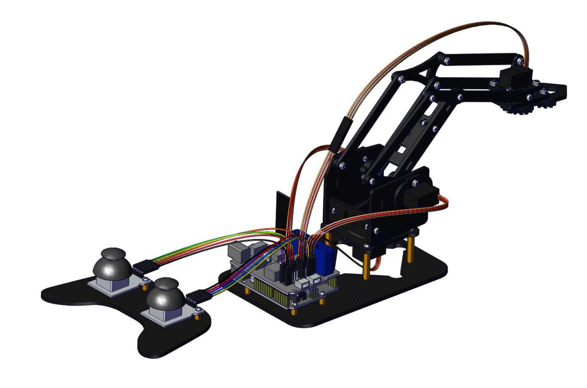
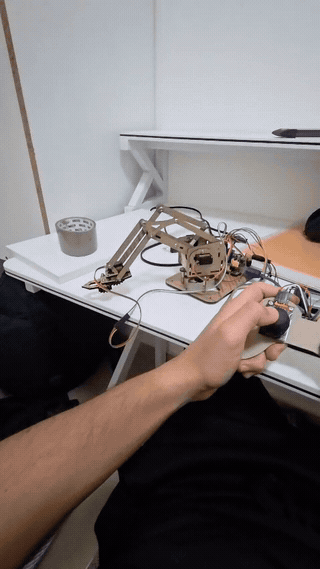
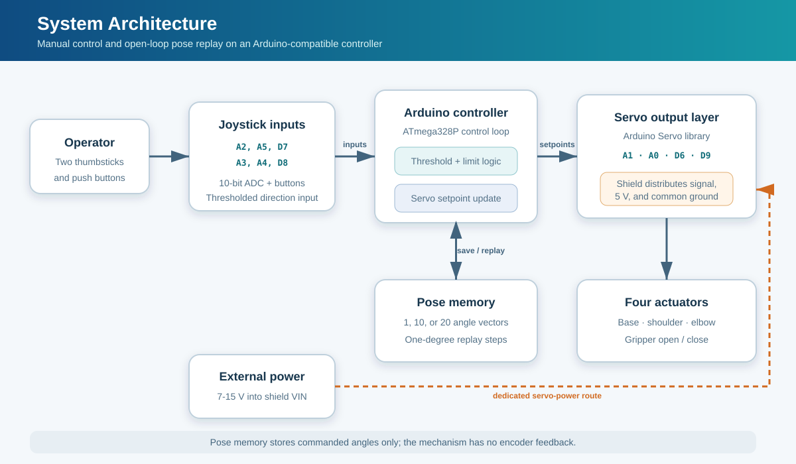
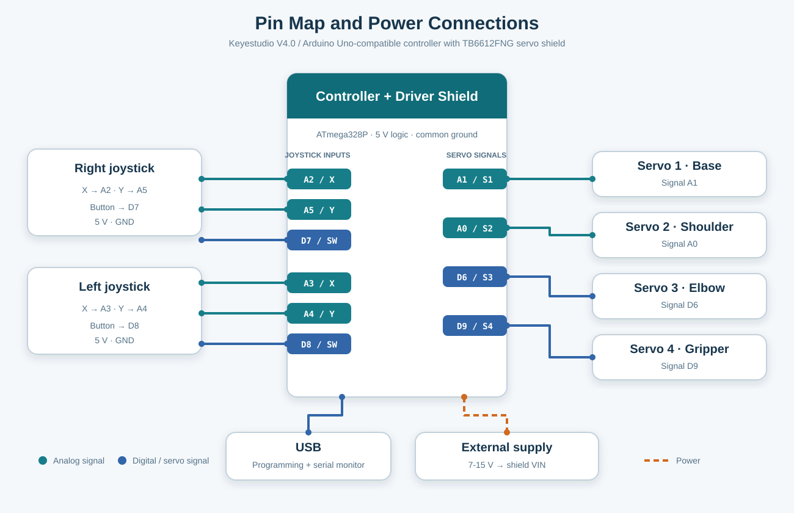
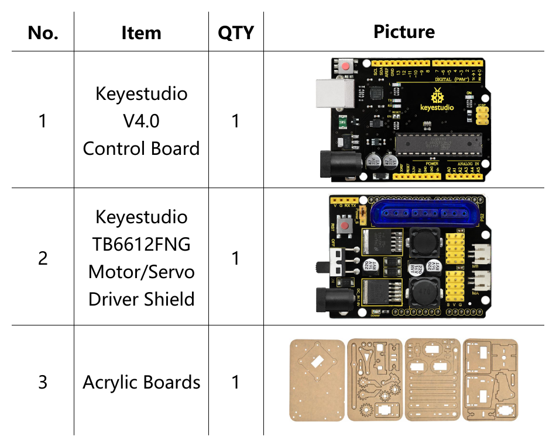
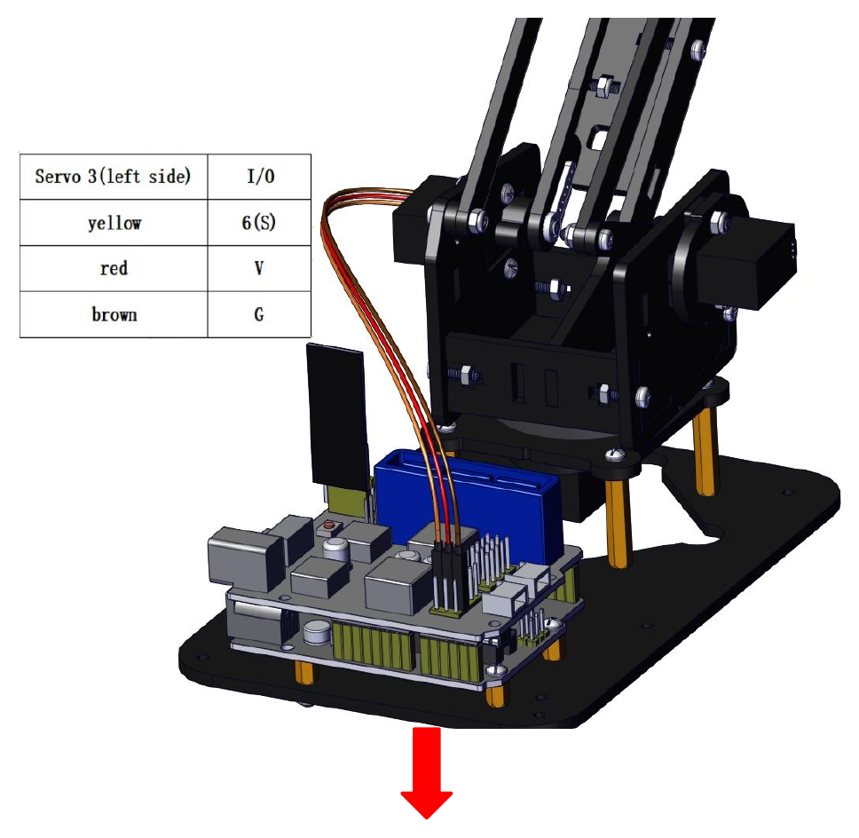
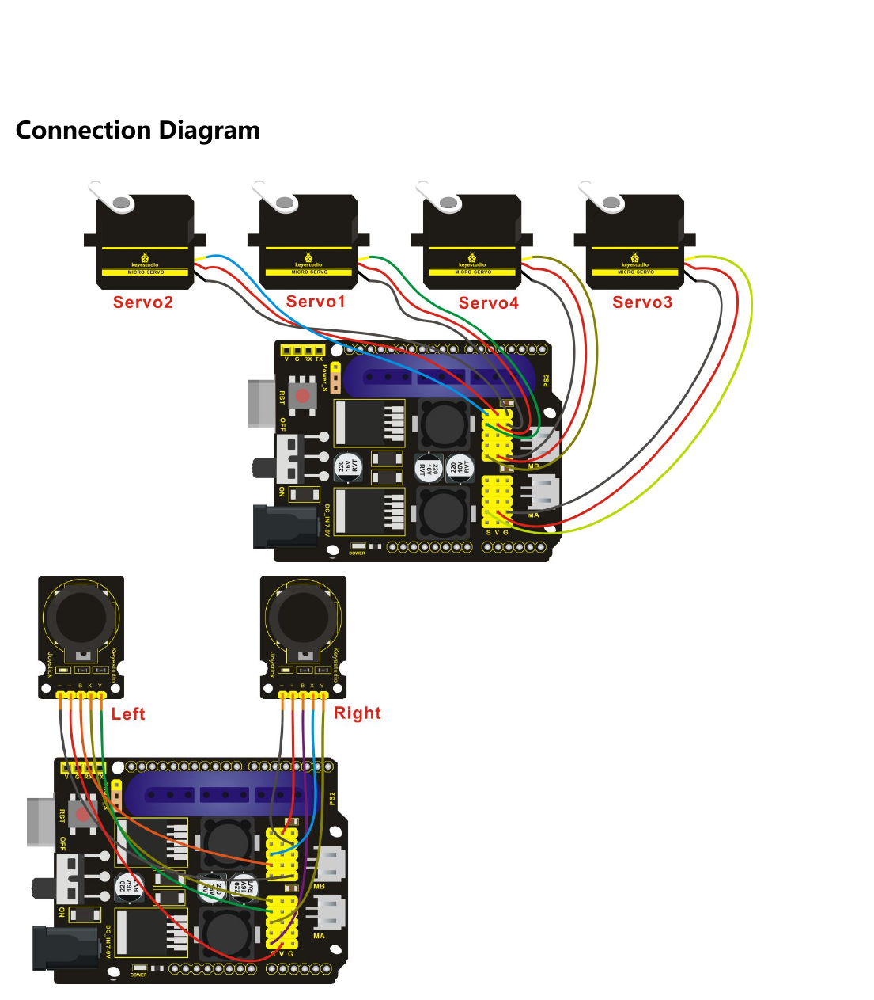

# Arduino 4DOF Robot Arm

> **Engineering notebook:** [Open the complete theory - Arduino C++ - visual results - interpretation notebook](notebooks/robot_arm_engineering_notebook.ipynb)

An Arduino C++ control suite for a four-degree-of-freedom desktop robot arm, covering servo calibration, dual-joystick control, pose capture, and open-loop pose replay.

<p align="center">
  
</p>

<p align="center"><em>Complete Keyestudio 4DOF arm, controller shield, and dual-joystick interface.</em></p>

[Notebook](notebooks/robot_arm_engineering_notebook.ipynb) | [Demo](#demo) | [Architecture](#system-architecture) | [Hardware](#hardware-and-wiring) | [Sketches](#arduino-sketches) | [Build](#build-and-upload)

## Project at a Glance

| Category | Project implementation |
|---|---|
| Embedded language | Arduino C++ |
| Controller | Keyestudio V4.0 / Arduino Uno-compatible ATmega328P |
| Inputs | Two analog joysticks and two push buttons |
| Outputs | Four hobby servos: base, two arm joints, and gripper |
| Control modes | Calibration, fixed sequence, manual control, pose capture, and replay |
| Pose capacity | Single pose, 10-pose sequence, or 20-pose looping sequence |
| Feedback model | Open-loop commanded angles; no joint encoders |

The project progresses from isolated actuator tests to manual control and pose-memory experiments. The implementation remains on the Arduino: Python is used only for supplemental calculations in the engineering notebook.

Key capabilities:

- Individual servo calibration at 0, 80, and 180 degrees.
- A fixed pick-and-place-style motion sequence.
- Raw acquisition of two analog joysticks and their push buttons.
- Manual control of base rotation, two arm joints, and the gripper.
- Capture and replay of one pose, up to 10 poses, or a looping sequence of up to 20 poses.
- Guarded pose storage, edge-triggered button handling, and endpoint-safe motion commands.

## Demo



## System Architecture



The joystick sketches read two 10-bit analog axes per joystick and convert near-endpoint readings into incremental joint commands. The memory sketches store the last commanded servo angles; they do not measure physical joint position because the mechanism has no encoders.

## Hardware and Wiring

- Keyestudio V4.0 or Arduino Uno-compatible ATmega328P board.
- Keyestudio TB6612FNG motor/servo driver shield.
- Four 180-degree hobby servos.
- Two dual-axis analog joystick modules with push buttons.
- 7-15 V supply connected to the driver shield VIN input.
- USB cable, jumper wiring, and the 4DOF mechanical arm kit.

> [!CAUTION]
> Power the servos through the driver shield, keep all grounds common, and confirm the shield input polarity before applying external power. Test with the arm unloaded and keep hands clear of the linkage.

## Pin Map



| Function | Arduino pin |
|---|---:|
| Servo 1 - base rotation | A1 |
| Servo 2 - right-side arm joint | A0 |
| Servo 3 - left-side arm joint | D6 |
| Servo 4 - gripper | D9 |
| Right joystick X / Y / button | A2 / A5 / D7 |
| Left joystick X / Y / button | A3 / A4 / D8 |

## Hardware Reference Images

The following excerpts from the supplied Keyestudio KS0198 tutorial complement the project-specific diagrams above.

<p align="center">
  
  
</p>

<p align="center"><em>Core kit components (left) and the Servo 3 horn and linkage assembly step (right).</em></p>

<p align="center">
  
</p>

<p align="center"><em>Vendor wiring overview for all four servos and both joystick modules. Use the source-verified pin map above as the software reference.</em></p>

## Arduino Sketches

Each program is stored in its own Arduino sketch directory, so it can be opened and compiled independently.

### Hardware tests

- [`servo_0`](hardware_tests/servo_0/servo_0.ino) - generate a 0-degree test command.
- [`servo_80`](hardware_tests/servo_80/servo_80.ino) - generate an 80-degree test command.
- [`servo_180`](hardware_tests/servo_180/servo_180.ino) - generate a 180-degree test command.

### Basic programs

- [`servo_basic_test`](basic_programs/servo_basic_test/servo_basic_test.ino) - drive a single servo through the Servo library.
- [`servo_control`](basic_programs/servo_control/servo_control.ino) - execute a fixed multi-joint motion sequence.

### Joystick control

- [`read_joystick_values`](joystick_control/read_joystick_values/read_joystick_values.ino) - inspect raw joystick values at 9600 baud.
- [`dual_joystick_control`](joystick_control/dual_joystick_control/dual_joystick_control.ino) - manually control all four servos.

### Pose memory

- [`memory_single_pose`](memory_programs/memory_single_pose/memory_single_pose.ino) - capture and replay one commanded pose.
- [`memory_multiple_poses`](memory_programs/memory_multiple_poses/memory_multiple_poses.ino) - record and replay up to 10 poses once.
- [`memory_with_loop`](memory_programs/memory_with_loop/memory_with_loop.ino) - record up to 20 poses and loop until the right joystick button is pressed.

## Build and Upload

1. Install the Arduino IDE and, if required by the board, the CP2102 USB driver.
2. Stack the driver shield on the controller and connect the servos and joysticks according to the pin map.
3. Open the directory of exactly one sketch, for example `joystick_control/dual_joystick_control/`.
4. Select **Arduino Uno** (or the matching Keyestudio Uno-compatible board) and the detected serial port.
5. Verify the sketch, connect external servo power, and upload it.
6. Open the Serial Monitor at **9600 baud** for sketches that report values or memory status.

Start with the hardware tests. Servo direction and mechanically safe angle limits depend on assembly orientation, so verify each joint before running a multi-servo sketch.

## Control and Memory Model

The joystick axes are sampled in the range 0-1023. Commands are issued when an axis is below 50 or above 1000; the range between those thresholds is neutral. Pose replay advances one servo at a time in one-degree steps with a 5 ms command interval.

For a saved joint vector \(\mathbf{q}_k\), the approximate command time for a sequential transition is

$$
t_k \approx 5\,\mathrm{ms}\sum_{i=1}^{4}\left|q_{i,k}-q_{i,k-1}\right|.
$$

See the [engineering notebook](notebooks/robot_arm_engineering_notebook.ipynb) for the complete theory-code-result-interpretation narrative.

To open it locally:

```bash
python -m pip install -r notebooks/requirements.txt
jupyter lab notebooks/robot_arm_engineering_notebook.ipynb
```

## Verified Results and Evidence

- The source implements all pin assignments and control paths shown above.
- All 10 sketches pass host-side C++ syntax validation with a minimal Arduino API stub.
- The supplied video documents a physically assembled mechanism.
- The vendor tutorial reports successful servo, joystick, single-pose, multi-pose, and loop demonstrations.
- Pulse timing and replay timing in the notebook are calculated from the source code; they are not experimental measurements.

No encoder accuracy, repeatability, current, payload, or Cartesian-position measurements are available in this repository.

## Known Limitations

- `Servo.read()` returns the last commanded angle, not measured joint feedback.
- Playback is blocking and sequential rather than time-synchronized across joints.
- Joystick thresholds and servo limits require hardware-specific calibration.
- All sketches use the same numerical Servo 3 angle direction, but the vendor control table describes the resulting extend/retract motion in the opposite way. Confirm the physical joint motion before changing the labels or mapping.
- A board-specific Arduino Uno compile is still pending because `arduino-cli` is not installed in this workspace; the host-side syntax check does not replace that toolchain verification.

## Repository Structure

```text
.
|-- assets/                 # project media, diagrams, and vendor reference images
|-- basic_programs/         # single-servo and fixed-sequence sketches
|-- hardware_tests/         # independent calibration sketches
|-- joystick_control/       # joystick acquisition and manual control
|-- memory_programs/        # single, multiple, and looping pose memory
|-- notebooks/              # engineering knowledge base
|-- LICENSE
`-- README.md
```

## License

Released under the [MIT License](LICENSE).
